<div align="center">


<p>
  <a href="https://github.com/aniruddhaadak80/re/actions/workflows/ci.yml"></a>
  <a href="LICENSE"></a>
  
  
  <a href="docs/mcp.md"></a>
  <a href="CONTRIBUTING.md"></a>
</p>

<h3>Look inside any binary, bundle or package. In your browser, your terminal, or your agent.</h3>

<p>
  <a href="https://aniruddhaadak80.github.io/re/"><b>Open the web app</b></a> ·
  <a href="https://aniruddhaadak80.github.io/re/docs">Docs</a> ·
  <a href="https://aniruddhaadak80.github.io/re/blog">Blog</a> ·
  <a href="docs/getting-started.md">Getting started</a> ·
  <a href="docs/comparison.md">How it compares</a>
</p>

<code>npx revlens analyze ./your-file</code>

</div>


## Why RevLens

Most reverse engineering tools ask you to install something large before you can ask a small question. Is this binary packed? Which npm packages are inside this bundle, and are any of them vulnerable? What can this browser extension actually do? Did the new release add a network endpoint?

RevLens answers those questions in about a second, with no install beyond Node or a browser tab. The whole engine is pure TypeScript with zero native dependencies. It takes a `Uint8Array` and gives back one structured report, so the same code runs in three places:

- **In the browser**, inside a Web Worker. Your file never leaves your machine.
- **In the terminal**, as `npx revlens`, with JSON, Markdown, HTML, SARIF and CycloneDX output.
- **In your agent**, as an MCP stdio server with 12 small tools for Claude Code, Codex, Cursor, Gemini CLI and anything else that speaks MCP.

We are not trying to replace Ghidra, IDA or radare2. RevLens is the fast triage and supply chain layer that runs first. When a file needs real decompilation, we tell you, and you hand it to REA, GhidraMCP, ida-pro-mcp or r2mcp with a clear head start.

## Quick start

### In the browser

Open **[aniruddhaadak80.github.io/re](https://aniruddhaadak80.github.io/re/)** and drop a file on the page, or press one of the "Try a sample" buttons. Analysis runs in a Web Worker on your device. Nothing is uploaded.

### In the terminal

```bash
# analyze a file and print a readable summary
npx revlens analyze ./esbuild.exe

# write machine readable output
npx revlens analyze ./ublock.xpi --json --out report.json
npx revlens analyze ./dist/app.js --md --out report.md
npx revlens analyze ./dist/app.js --html --out report.html

# supply chain
npx revlens sbom ./dist/app.js --cyclonedx --out bom.json
npx revlens sbom ./dist/app.js --osv            # opt in network lookup on OSV.dev

# code scanning
npx revlens sarif ./build/app.exe --out revlens.sarif

# compare two releases
npx revlens diff ./esbuild-0.23.0.exe ./esbuild-0.24.0.exe

# your own rules
npx revlens rules ./suspicious.bin --rules ./my-rules.yar

# check a claim against the bytes
npx revlens verify ./esbuild.exe --claim '{"kind":"imports-symbol","symbol":"CreateRemoteThread"}'
```

The full reference lives in [docs/cli.md](docs/cli.md).

### In your agent (MCP)

RevLens ships a stdio MCP server, `@revlens/mcp`. Pick your client:

<details open>
<summary><b>Claude Code</b></summary>

```bash
claude mcp add revlens -- npx -y @revlens/mcp
```

Or commit a project scoped `.mcp.json`:

```json
{
  "mcpServers": {
    "revlens": {
      "command": "npx",
      "args": ["-y", "@revlens/mcp"]
    }
  }
}
```
</details>

<details>
<summary><b>OpenAI Codex CLI</b></summary>

Codex reads TOML from `~/.codex/config.toml`:

```toml
[mcp_servers.revlens]
command = "npx"
args = ["-y", "@revlens/mcp"]
```
</details>

<details>
<summary><b>Cursor</b></summary>

Add this to `~/.cursor/mcp.json` (global) or `.cursor/mcp.json` (per project):

```json
{
  "mcpServers": {
    "revlens": {
      "command": "npx",
      "args": ["-y", "@revlens/mcp"]
    }
  }
}
```
</details>

<details>
<summary><b>Gemini CLI</b></summary>

Add this to `~/.gemini/settings.json`:

```json
{
  "mcpServers": {
    "revlens": {
      "command": "npx",
      "args": ["-y", "@revlens/mcp"]
    }
  }
}
```
</details>

The server exposes 12 tools: `analyze_file`, `list_findings`, `get_strings`, `get_sections`, `get_imports`, `sbom`, `check_vulns`, `scan_rules`, `diff_files`, `verify_claim`, `hexdump` and `list_analyzers`. See [docs/mcp.md](docs/mcp.md) for what each one returns.

### As a library

```ts
import { readFile } from 'node:fs/promises';
import { analyze, toSARIF, verifyClaim } from '@revlens/core';

const bytes = new Uint8Array(await readFile('esbuild.exe'));
const report = await analyze(bytes, { name: 'esbuild.exe' });

console.log(report.file.format, report.file.arch);   // pe x86-64
console.log(report.hardening?.imphash);              // b196866f0bf37f1f128fa153413b744f
console.log(verifyClaim(bytes, { kind: 'imports-symbol', symbol: 'CreateRemoteThread' }, report).verdict); // REFUTED
```


## What it finds

RevLens runs 15 analyzers in a fixed order: structure first, then content, then rules. Each one decides for itself whether it applies to the file. Full details, including limits, are in [docs/analyzers.md](docs/analyzers.md).

| Analyzer | Reads | Reports |
| --- | --- | --- |
| `elf` | ELF headers, section table, `.dynamic`, `.dynsym` | arch, bits, endianness, sections with entropy, `DT_NEEDED` libraries, imported and exported dynamic symbols, PIE, stripped, NX and RELRO hints |
| `pe` | DOS and PE headers, section table, import directory, certificate directory | arch, subsystem, sections with entropy, imports per DLL, imphash (same value as pefile), ASLR, DEP, CFG, high entropy VA, Authenticode presence |
| `macho` | Mach-O header and load commands, fat header | arch, segments with entropy, linked dylibs, `LC_CODE_SIGNATURE` presence, entry point, universal binary slices |
| `wasm` | WebAssembly module sections | import modules and fields, exports, custom sections such as `producers` and `go:buildid` |
| `buildinfo` | Go build info block, rustc markers | Go toolchain version, main module, build settings, module dependencies as components, Rust markers |
| `entropy` | every byte, in 64 blocks | entropy map, high entropy warnings, packer markers (UPX, ASPack, MPRESS, Themida, VMProtect, Enigma, PECompact, Petite), JavaScript obfuscator fingerprints |
| `strings` | printable ASCII and UTF-16LE runs | the most interesting strings first, tagged as url, email, registry, guid, command, ip, path or version |
| `archive` | ZIP, JAR, APK, CRX, XPI, VSIX, npm tarball, gzip, tar, Electron ASAR | member list, zip slip names, decompression bomb ratio, and recursive child reports for up to 60 important members |
| `extaudit` | `manifest.json`, `package.json`, VSIX metadata | risky extension permissions, all sites host access, weak CSP, Manifest V2, VS Code activation on startup, npm install scripts, remote script URLs |
| `sbom` | JS bundles and `package.json` | npm components with versions and purl ids, from banners, `@license` comments, runtime version constants and `node_modules/` paths, plus the bundler |
| `sourcemap` | `sourceMappingURL`, inline data URI maps, `.map` files | external map references, how many original files a map lists and what share ships full source in `sourcesContent` |
| `secrets` | text, or tagged strings for binaries | AWS, Google, GitHub, Slack, Stripe, OpenAI, Anthropic, npm, SendGrid and Twilio tokens, JWTs, private keys, high entropy secret assignments, always redacted |
| `surface` | text, or strings for binaries | URLs and hosts, API paths, GraphQL operations, Electron IPC channels, feature flag keys, storage keys, plain HTTP endpoints |
| `capa` | imports, strings, text | capabilities such as "inject into another process" or "read environment secrets", each mapped to MITRE ATT&CK |
| `yara` | every byte | matches from the 13 rule starter pack plus your own rules in the yara-lite language |

Every file also gets MD5, SHA-1, SHA-256, a TLSH-like locality digest and a CTPH (ssdeep style) fuzzy hash, all computed in pure TypeScript.


## Real example output

Everything below is real output from RevLens 0.1.0 on public files. Nothing is edited except for trimming long lists.

### A Go binary for Windows: `esbuild.exe` 0.24.0

From the `@esbuild/win32-x64@0.24.0` npm package. Analysis took about 1.5 seconds in Node 22.

```text
# RevLens report: esbuild.exe

| Field   | Value                                                            |
| ------- | ---------------------------------------------------------------- |
| Format  | pe, x86-64, 64 bit                                               |
| Size    | 10,430,464 bytes                                                 |
| SHA-256 | 26c4c83aa3284a24d014792496aea46dc5149f767c8ce3fafdfccfa084598de4 |
| Entropy | 6.21 bits per byte                                               |

## Findings
Totals: critical 0, high 0, medium 0, low 1, info 2.
- LOW  1 plain HTTP endpoints. Traffic to http://.pnp.jsbaseUrlUpgradeTrailersocks5hHEADERS ...
- INFO Built with go1.23.1. This is a Go binary compiled with go1.23.1. (offset 9913344)
- INFO Rule Crypto_Constants matched. AES S-box or SHA-256 round constants (offset 9938976)

## Capabilities
- access the network (T1071): WSASocket, getaddrinfo, XMLHttpRequest
- resolve DNS: getaddrinfo
- read or write the registry (T1112): RegQueryValue, RegCreateKey
- enumerate files: FindFirstFile, GetFileAttributes
- read environment secrets (T1552): process.env
```

The hardening block carries the import hash. It matches `pefile.PE(...).get_imphash()` byte for byte:

```json
{
  "subsystem": "Windows console",
  "aslr": true,
  "dep_nx": true,
  "cfg": false,
  "highEntropyVA": true,
  "signed": false,
  "imphash": "b196866f0bf37f1f128fa153413b744f"
}
```

That LOW finding is honest noise, and we keep it on purpose as an example. Go packs its string literals end to end with no separators, so a URL prefix runs into its neighbours. RevLens shows you the evidence so you can dismiss it in a second.

### A browser extension: uBlock Origin 1.76.0 for Firefox

```text
Format xpi, 6,341,734 bytes, 671 members, 60 analyzed as child reports, 1.36 s

HIGH    Extension asks for "<all_urls>"
HIGH    Extension can read and change every site
MEDIUM  Extension asks for "privacy"
MEDIUM  Extension asks for "webRequest"
MEDIUM  Extension asks for "webRequestBlocking"
LOW     1 plain HTTP endpoints (in lib/punycode.js)
LOW     Extension asks for "tabs"
LOW     Manifest V2 extension
```

None of this means uBlock Origin is bad. A content blocker needs to see every request. It does mean that if any extension with this permission set is ever compromised, it can read every page you open. That is exactly what you want to know before you install one. The full story is in the blog post [What is inside uBlock Origin](content/blog/inside-ublock-origin.md).

### A release diff: esbuild 0.23.0 to 0.24.0

```text
Between esbuild-0.23.0.exe and esbuild-0.24.0.exe: 2 endpoint changes, 1 import change, 5 section changes.

imports removed   kernel32.dll!CreateFileA
imphash           07361a3a7f515bf56ca93120b2aca73b -> b196866f0bf37f1f128fa153413b744f
Go toolchain      go1.22.4 -> go1.23.1
.text             5,308,928 -> 5,455,872 bytes
.rdata            4,411,904 -> 4,455,936 bytes
```

### A claim check

An agent says "this binary injects code with CreateRemoteThread". RevLens checks the bytes:

```json
{
  "verdict": "REFUTED",
  "claim": { "kind": "imports-symbol", "library": "kernel32.dll", "symbol": "CreateRemoteThread" },
  "reason": "The symbol is not in the import table or anywhere in the file.",
  "evidence": []
}
```


## How it compares

We read every project's README and docs on 2026-11-10. If we got something wrong, please open a pull request and we will fix it fast. "Partial" means the feature exists through an external tool or in a narrow form.

| | **RevLens** | [REA](https://github.com/morluto/rea) | [GhidraMCP](https://github.com/LaurieWired/GhidraMCP) | [ida-pro-mcp](https://github.com/mrexodia/ida-pro-mcp) | [r2mcp](https://github.com/radareorg/radare2-mcp) | [jshookmcp](https://github.com/vmoranv/jshookmcp) |
| --- | --- | --- | --- | --- | --- | --- |
| What you install | Node, or nothing (browser) | Node plus engines you choose | Ghidra, Java, plugin | IDA Pro license | radare2 | Node, browser automation |
| Runs in the browser | Yes | No | No | No | No | No |
| Deep decompilation | No, hands off | Yes, through engines | Yes | Yes | Yes | Partial, through bridges |
| ELF, PE, Mach-O headers and imports | Yes | Yes | Yes | Yes | Yes | Partial |
| Entropy and packer detection | Yes | No | No | No | Partial | Partial |
| YARA style rules, no native yara | Yes | No | No | No | Partial | No |
| Capabilities mapped to ATT&CK | Yes | No | No | No | No | No |
| SBOM from JS bundles | Yes | No | No | No | No | No |
| OSV vulnerability lookup | Yes, opt in | No | No | No | No | No |
| Source map detection | Yes | Partial | No | No | No | Yes, with rebuild |
| Secrets scanning | Yes | Partial | No | No | No | Partial |
| Extension, VSIX and npm tarball audit | Yes | No | No | No | No | No |
| Release to release diff | Yes | Partial | No | No | Partial | No |
| SARIF for code scanning | Yes | No | No | No | No | No |
| Claim verification against bytes | Yes | Partial, evidence first | No | No | No | No |
| Runtime hooking (Frida) | No | Yes | No | No | No | Yes |
| License | MIT | MIT | Apache-2.0 | MIT | MIT | AGPL-3.0 |

The honest summary: if you need to read decompiled functions, rename variables or hook a running process, use one of the others. If you need answers about a file in seconds, in CI, in a browser tab or inside an agent loop with a small context budget, RevLens is built for that. They work well together. More in [docs/comparison.md](docs/comparison.md).


## Architecture

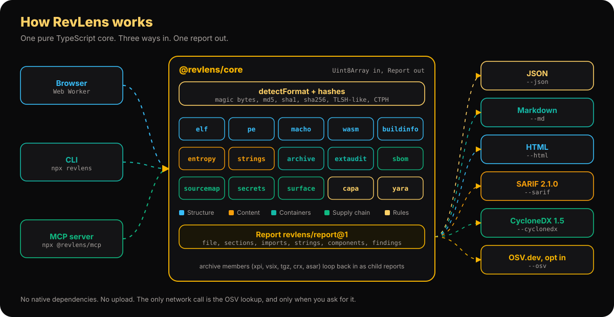

The core is a pure function of the bytes. It never touches the file system or the network. The CLI adds `node:fs`, the MCP server adds a stdio transport, and the web app adds a Web Worker. The only network call in the whole project is `lookupOSV`, and it runs only when you ask.

### 1. The analysis pipeline

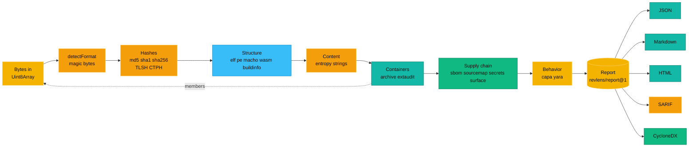

### 2. How one analyzer runs

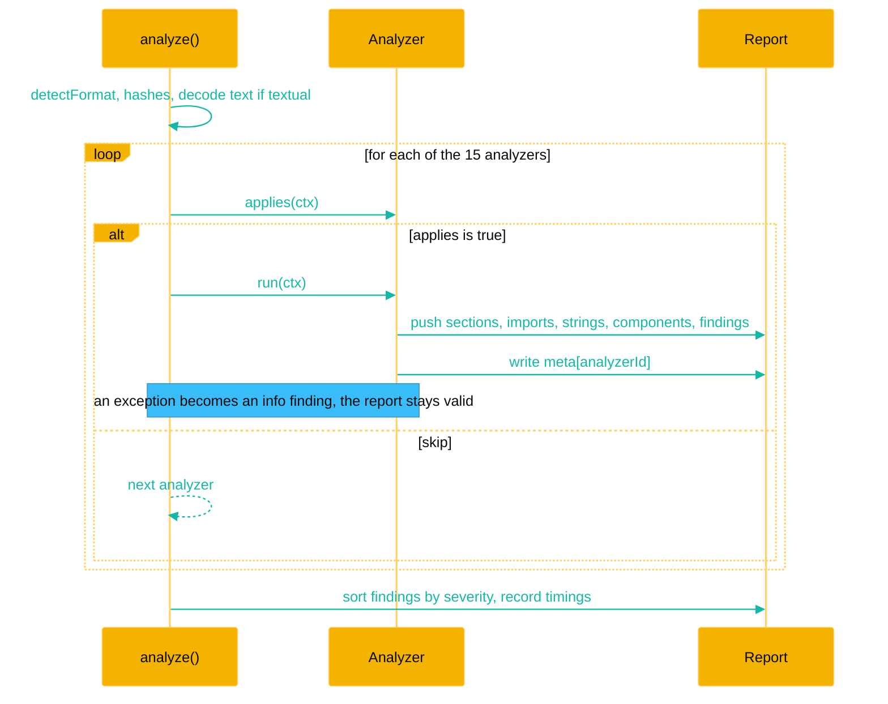

### 3. An agent asks a question over MCP

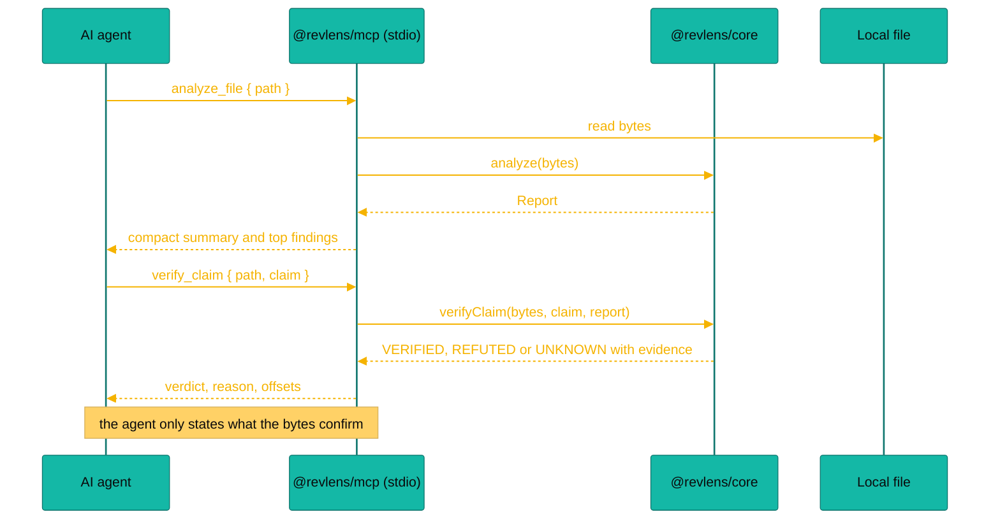

### 4. The report data model

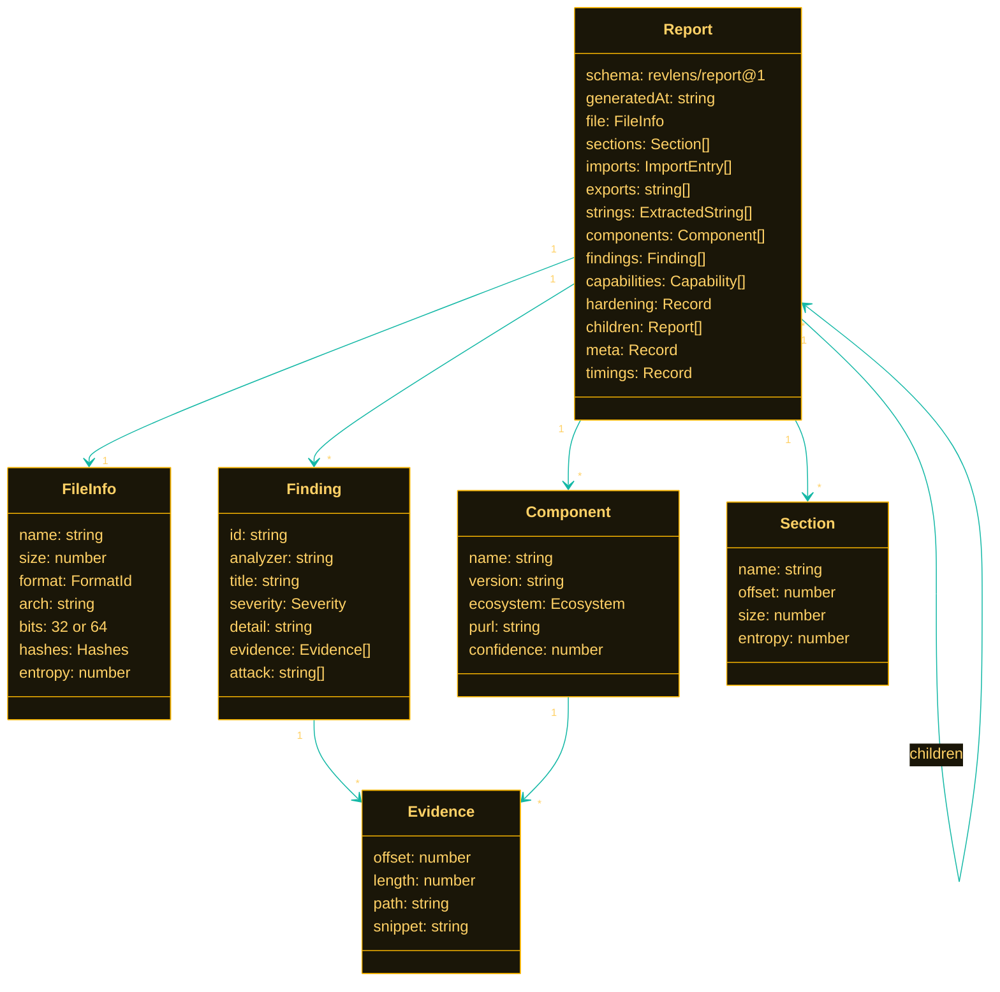

### 5. SARIF in GitHub code scanning

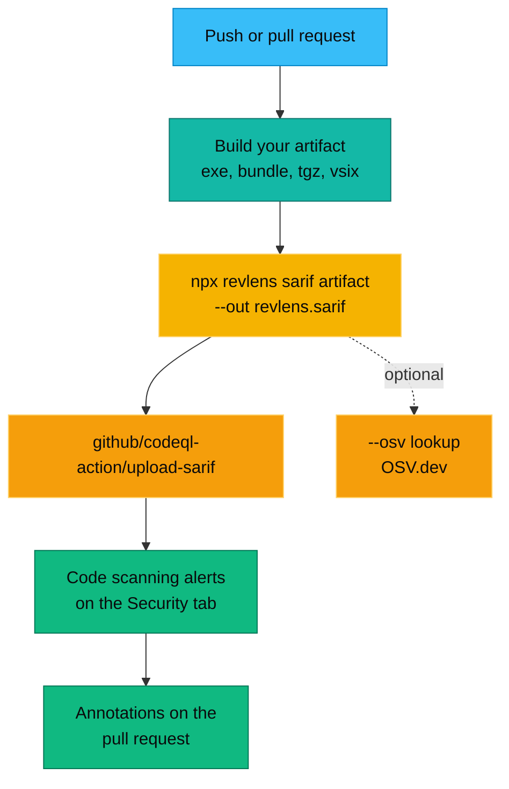

### 6. Verifying a claim

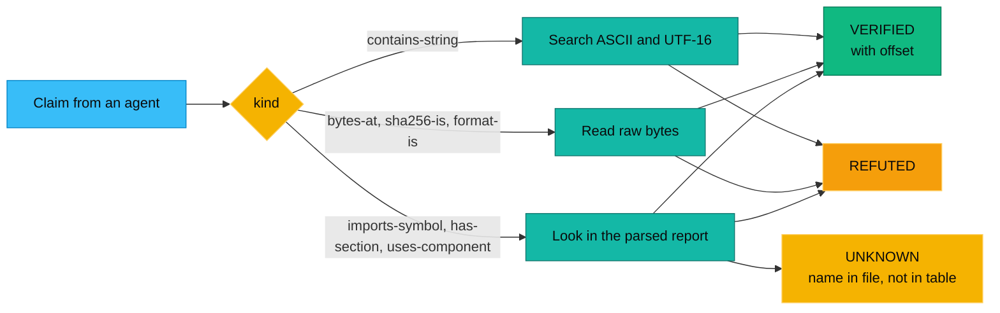

### 7. Roadmap

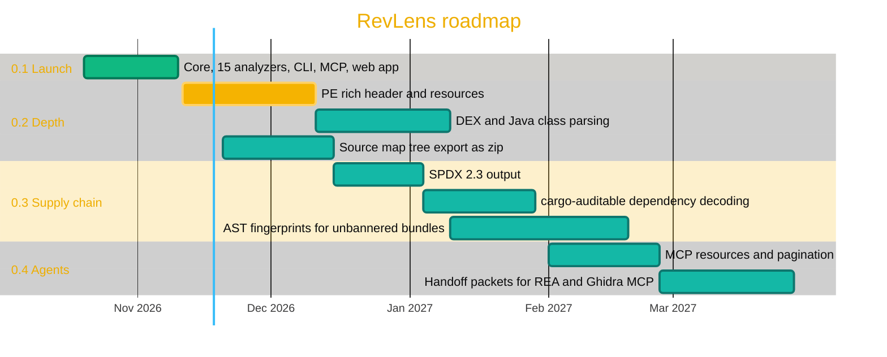


## yara-lite in one minute

RevLens includes a pure TypeScript engine for a practical subset of the YARA language. No native `yara` binary, no WASM blob. Rules you already have for strings and hex patterns usually work as they are.

```yara
rule Go_Binary : lang
{
  meta:
    description = "Go build info and runtime strings"
    severity = "info"
  strings:
    $magic = { FF 20 47 6F 20 62 75 69 6C 64 69 6E 66 3A }
    $rt    = "runtime.gopanic"
    $ver   = /go1\.[0-9]{2}\.[0-9]+/
  condition:
    $magic and ($rt or $ver)
}
```

That rule matches the real `esbuild.exe` with `$magic` at offset 9913344. Supported today:

- **Strings:** text with `nocase`, `wide`, `ascii` and `fullword`, hex with `??` wildcards and `[n]` or `[n-m]` jumps, and regex with `i` and `s` flags.
- **Conditions:** `and`, `or`, `not`, parentheses, `any of them`, `all of them`, `N of them`, `N of ($a*, $b)`, `#a > N`, `@a[i]`, `$a at N`, `$a in (N..M)`, `filesize`, `KB` and `MB`, `uint8`, `uint16`, `uint32` and their `be` forms, and `+ - * \ & |` arithmetic.
- **Meta:** `severity` and `attack` in meta turn into the finding severity and its ATT&CK id.

Not supported yet: modules such as `pe.` and `math.`, `for` loops, hex alternations, and private or global rule semantics. The full reference with tested examples is in [docs/rules.md](docs/rules.md).

## SARIF in GitHub code scanning

Drop this into `.github/workflows/revlens.yml`. It analyzes your build output on every push and pull request and shows findings on the Security tab and as pull request annotations.

```yaml
name: RevLens
on:
  push:
    branches: [main]
  pull_request:

permissions:
  contents: read
  security-events: write

jobs:
  scan:
    runs-on: ubuntu-latest
    steps:
      - uses: actions/checkout@v4
      - uses: actions/setup-node@v4
        with:
          node-version: 22
      - run: npm ci && npm run build
      - name: Analyze the build output
        run: npx -y revlens sarif ./dist/app.js --out revlens.sarif
      - name: Upload to code scanning
        uses: github/codeql-action/upload-sarif@v4
        with:
          sarif_file: revlens.sarif
          category: revlens
```

More recipes, including several artifacts per run and failing the job on high findings, are in [docs/sarif-and-ci.md](docs/sarif-and-ci.md).


## Screenshots

<table>
  <tr>
    <td width="50%">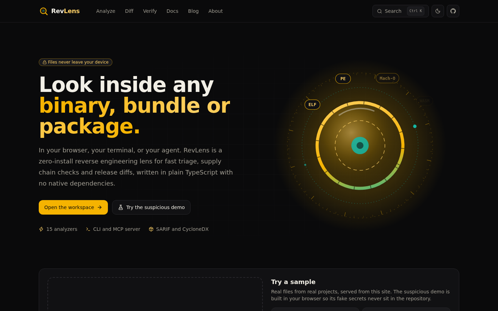<br /><sub>Drop a file or try a sample. Everything runs in your browser.</sub></td>
    <td width="50%">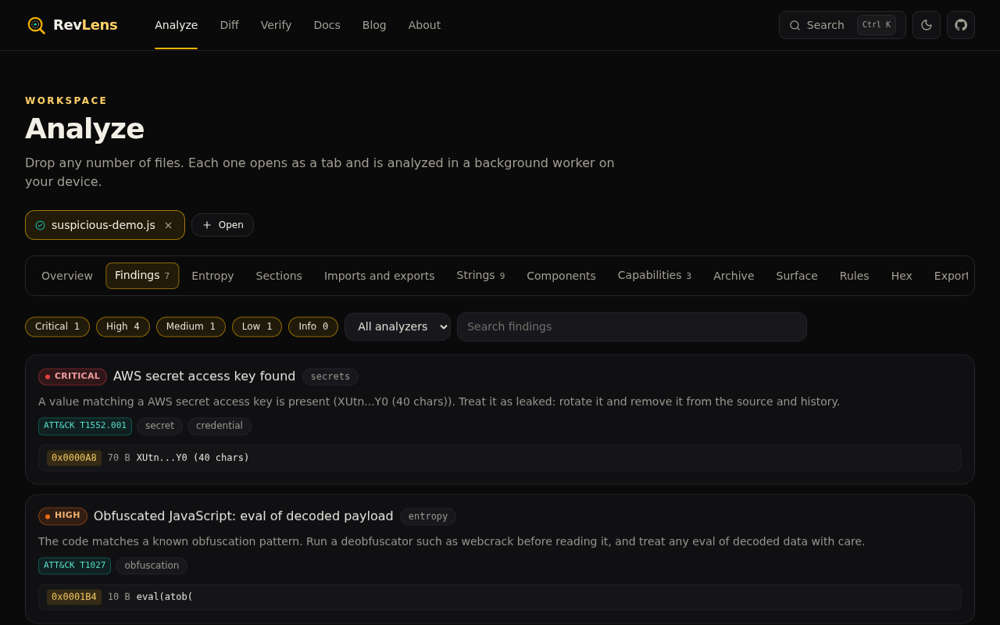<br /><sub>Findings sorted by severity, each with its evidence.</sub></td>
  </tr>
  <tr>
    <td width="50%"><br /><sub>The entropy map shows packed or encrypted regions at a glance.</sub></td>
    <td width="50%">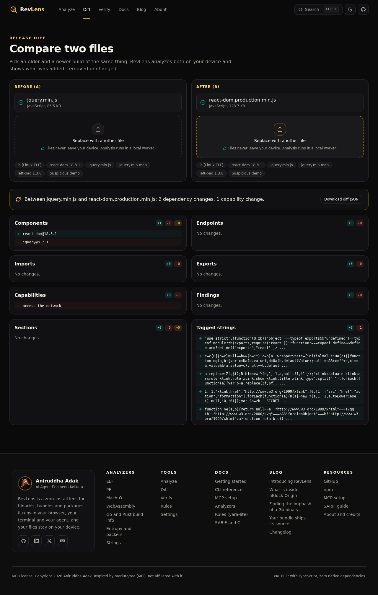<br /><sub>Diff two releases and see what changed that matters.</sub></td>
  </tr>
</table>

## Roadmap

These are the things we want to build next, roughly in order. Ideas and pull requests are welcome on every one of them.

- **Deeper PE:** rich header, version resources, overlay detection and certificate parsing.
- **More formats:** DEX and Java class files, Python `.pyc`, PDF objects.
- **Source map recovery:** export the rebuilt source tree as a zip from the web app.
- **SBOM depth:** SPDX 2.3 output, cargo-auditable decoding, and AST fingerprints for bundles that strip banners.
- **yara-lite:** hex alternations, `for` loops and a small `pe` module.
- **Agents:** MCP resources with pagination, and handoff packets that give REA, GhidraMCP or ida-pro-mcp a ready list of addresses to look at.

## Contributing

We would love your help. A new packer marker, a secret pattern, a rule for the starter pack or a fixed false positive are all great first pull requests. Read [CONTRIBUTING.md](CONTRIBUTING.md) for the setup, the test rules (real files, no format mocks) and the writing style. Please also read our [Code of Conduct](CODE_OF_CONDUCT.md). To report a security problem privately, see [SECURITY.md](SECURITY.md).

```bash
git clone https://github.com/aniruddhaadak80/re.git
cd re
npm install
npm test
npm run cli -- analyze samples/jquery.min.js
```

## Credits

- **[REA, Reverse Engineer Anything](https://github.com/morluto/rea)** by morluto (MIT). REA showed how good reverse engineering feels when an agent can drive it. RevLens is inspired by it and written from scratch. It is not affiliated with REA and is not an official REA project. We see the two as complementary.
- **[OSV.dev](https://osv.dev)** for the free, open vulnerability database and batch API behind `--osv`.
- **[MITRE ATT&CK](https://attack.mitre.org)** for the technique ids we map capabilities and rules to.
- The ideas behind our capa-lite and yara-lite engines come from **[Mandiant capa](https://github.com/mandiant/capa)** and **[YARA](https://github.com/VirusTotal/yara)**. The import hash follows the convention made popular by **[pefile](https://github.com/erocarrera/pefile)**.
- Sample files in `samples/` come from public npm packages and keep their original licenses.

## About the author

<table>
  <tr>
    <td width="140" valign="top"></td>
    <td valign="top">
      <b>Aniruddha Adak</b><br />
      AI agent engineer, full stack developer and open source contributor. I build tools that help agents and people see what software really does, and I care a lot about AI safety. RevLens is the tool I wanted every time an agent told me something about a binary that I could not check.<br /><br />
      <a href="https://github.com/aniruddhaadak80">GitHub</a> ·
      <a href="https://www.linkedin.com/in/aniruddha-adak">LinkedIn</a> ·
      <a href="https://x.com/asi369_">X</a> ·
      <a href="https://dev.to/aniruddhaadak">DEV</a> ·
      <a href="https://aniruddha-agency.vercel.app/">Portfolio</a>
    </td>
  </tr>
</table>

## License

[MIT](LICENSE). Copyright Aniruddha Adak and RevLens contributors.


