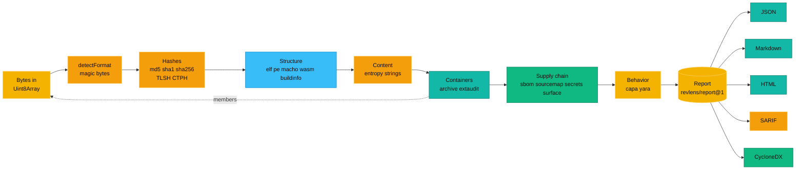
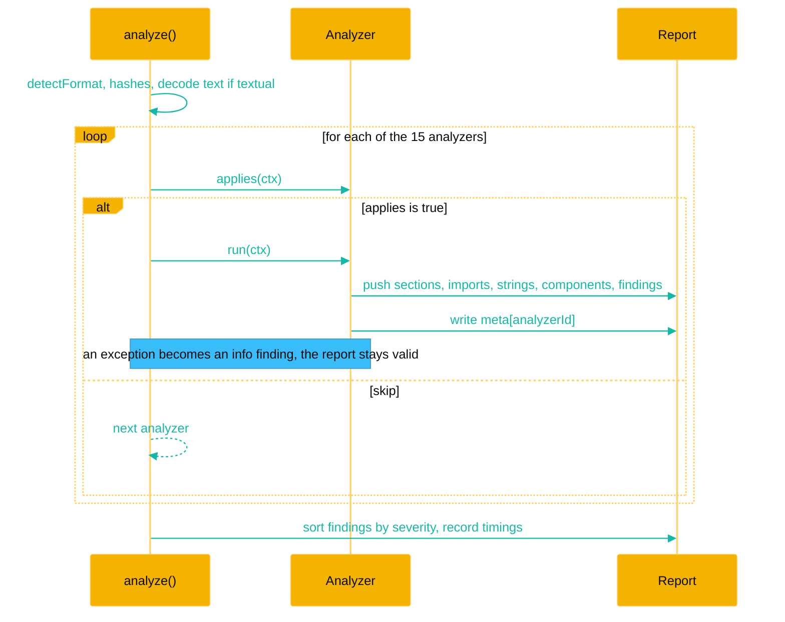
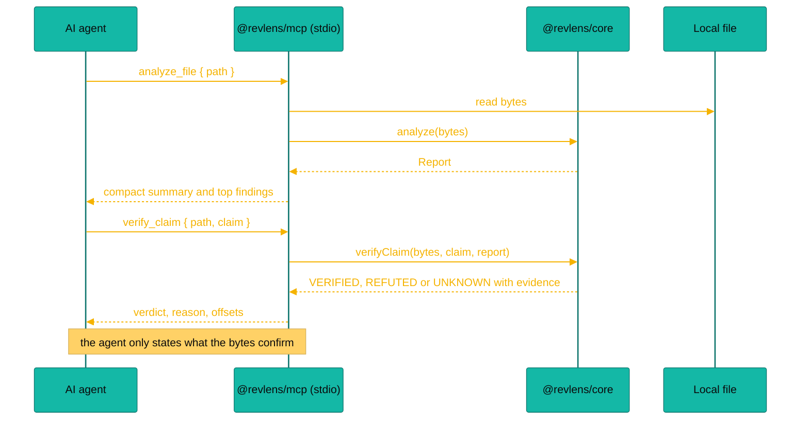
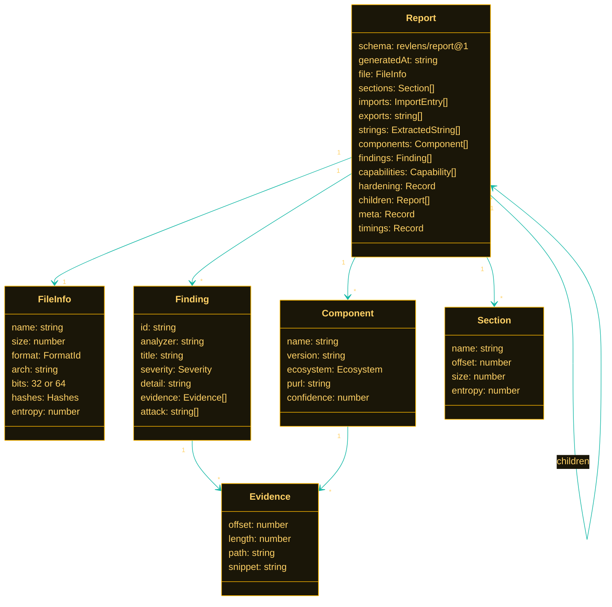
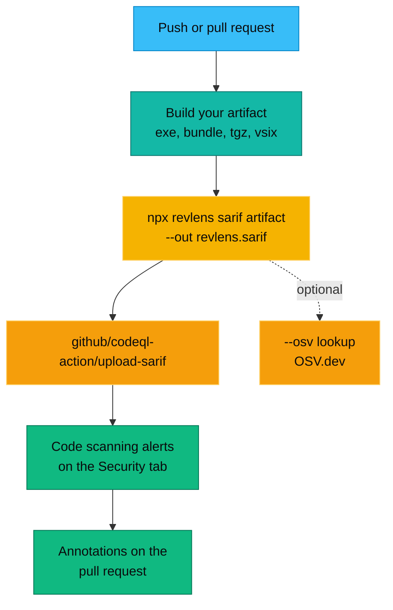
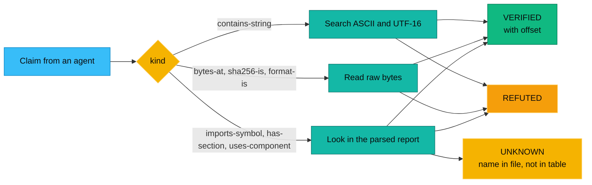

<div align="center">


<p>
  <a href="https://github.com/aniruddhaadak80/re/actions/workflows/ci.yml"></a>
  <a href="LICENSE"></a>
  
  
  <a href="docs/mcp-tools.md"></a>
  <a href="CONTRIBUTING.md"></a>
</p>

<h3>Reverse engineer anything you can put in a file. In your browser, your terminal, or your agent.</h3>

<p>
  <a href="https://aniruddhaadak80.github.io/re/"><b>Open the web app</b></a> ·
  <a href="https://aniruddhaadak80.github.io/re/labs">Tools</a> ·
  <a href="https://aniruddhaadak80.github.io/re/docs">Docs</a> ·
  <a href="docs/getting-started.md">Getting started</a> ·
  <a href="docs/comparison.md">How it compares</a>
</p>

<code>npx revlens setup claude-code --write</code>

<p><sub><b>English</b> · <a href="docs/readme/README.bn.md">বাংলা</a> · <a href="docs/readme/README.hi.md">हिन्दी</a> · <a href="docs/readme/README.zh.md">中文</a> · <a href="docs/readme/README.ja.md">日本語</a> · <a href="docs/readme/README.es.md">Español</a></sub></p>

</div>


## Why RevLens

You have a file and a question. Is this binary packed? What does `main` do? Which permissions does this APK ask for, and who signed it? What is inside this Electron app, this PyInstaller build, this .NET assembly? Which hosts does this capture talk to?

RevLens answers with evidence you can check: byte offsets, virtual addresses, section names and archive paths. The engine is TypeScript plus two WebAssembly decoders. It needs nothing native, so the same code runs in three places:

- **In the browser**, inside a Web Worker. Your file never leaves your machine.
- **In the terminal**, as `npx revlens`, with 110 commands and JSON, Markdown, HTML, SARIF and CycloneDX output.
- **In your agent**, as an MCP server with 196 tools, 2 prompts and 2 resources, plus a ready made skill and plugins for Claude Code and Codex.

When you do have Ghidra, radare2, jadx, ILSpy, Frida or gdb installed, RevLens drives them too, and `revlens doctor` tells you what is missing and how to install it.

RevLens is inspired by [REA, Reverse Engineer Anything](https://github.com/morluto/rea) by morluto. It is written from scratch and is not an official REA project.

## What it covers

| Area | Formats | What you get | Package |
| --- | --- | --- | --- |
| Triage, any file | ELF, PE, Mach-O, WASM, ZIP, JAR, APK, CRX, XPI, VSIX, npm tgz, ASAR, JS bundles, source maps | format, hashes (MD5, SHA, TLSH, CTPH), sections and entropy, imports with imphash, hardening, packers, strings, secrets, endpoints, ATT&CK capabilities, yara-lite rules, SBOM, OSV lookups, diffs, claim checks | `@revlens/core` |
| Native code | ELF, PE, Mach-O on x86, x86-64, AArch64, ARM, Thumb, Go pclntab | functions, control flow graphs, xrefs, call graph, call paths, byte and instruction search, readable pseudo code | `@revlens/disasm` |
| Android, Java, iOS | APK, DEX, JAR, class, IPA, IL2CPP metadata | manifest, signatures v1 to v3.1, smali matching baksmali, javap output, cross references, native libraries and JNI, IPA plist and entitlements, app frameworks | `@revlens/mobile` |
| Managed runtimes | .NET, Python pyc and PyInstaller, Lua and LuaJIT, BEAM, EVM | metadata and CIL, dis output for 3.7 to 3.13, PyInstaller extraction, luac listings, BEAM chunks, EVM selectors and proxies | `@revlens/managed` |
| JavaScript and Electron | JS, bundles, source maps, ASAR, live pages | beautify, deobfuscate, split bundles, endpoints, source recovery, Electron security audit, Playwright capture | `@revlens/webrt` |
| Network and data | PCAP, pcapng, HAR, SQLite | flows, DNS, HTTP, TLS SNI and JA3, HAR review, schema and read only SELECT | `@revlens/webrt` |
| Extras | ELF, PE, Mach-O, kernel modules, firmware (uImage, FIT, TRX, SquashFS, cpio, UEFI, UF2), GPU code, V8 and Hermes, GGUF and safetensors, LNK, Apple crash reports | C++, Rust and MSVC demangling, checksec, Go and Rust toolchain facts, deep PE (resources, version info, rich header, Authenticode), ELF notes and unwind ranges, Mach-O code signatures, an evidence and claims ledger, an agent eval harness | `@revlens/extras` |
| External tools | radare2, rizin, Ghidra, jadx, apktool, ILSpy, Frida, gdb, lldb, objdump, binwalk, adb, IDA, Binary Ninja | decompiled C, Java and C#, dynamic runs with consent, doctor and client setup | `@revlens/bridges` |
| One entry point | all of the above | `analyzeAll()` runs 36 analyzers into one report | `@revlens/engine` |

Each area has a docs page: [disassembler](docs/disassembler.md), [mobile](docs/mobile.md), [managed runtimes](docs/managed-runtimes.md), [JavaScript and Electron](docs/javascript-and-electron.md), [network and data](docs/network-and-data.md), [bridges, doctor and setup](docs/bridges.md), [MCP tools reference](docs/mcp-tools.md) and [agent skills and plugins](docs/agent-skills-and-plugins.md).

## Quick start

### Give your agent RevLens

```bash
npx revlens setup claude-code --write   # or codex, cursor, vscode, windsurf
npx revlens doctor                      # optional: see which external tools you have
```

Setup shows the change first and backs up your config before it writes. Restart the client and ask something like "Use RevLens to triage ./app.apk and tell me what it does". Prefer to edit configs by hand? Copy one from [examples/mcp](examples/mcp).

As a Claude Code plugin, with the skill included:

```
/plugin marketplace add aniruddhaadak80/re
/plugin install revlens@revlens
```

### In the browser

Open **[aniruddhaadak80.github.io/re](https://aniruddhaadak80.github.io/re/)** and drop a file, or open the [tools](https://aniruddhaadak80.github.io/re/labs) and press "Try a sample". Analysis runs in a Web Worker on your device. Nothing is uploaded.

### In the terminal

```bash
npx revlens analyze ./app.elf                 # every analyzer, readable summary
npx revlens decompile ./app.elf main          # pseudo code for one function
npx revlens apk ./app.apk                     # manifest, signatures, DEX, findings
npx revlens dotnet ./App.dll il "App.License::Check"
npx revlens pyinstaller ./tool.exe list
npx revlens electron-audit ./app.asar
npx revlens pcap-summary ./capture.pcap
npx revlens sqlite-query ./app.db "SELECT * FROM users LIMIT 5"
npx revlens verify ./app.elf string=api.example.com
npx revlens sarif ./dist/app.js --out revlens.sarif
npx revlens bridge ghidra_decompile ./app.elf --functions main
```

Every command takes `--json`. Run `npx revlens --help` for the full list, or see [docs/cli.md](docs/cli.md).

### As a library

```ts
import { readFile } from 'node:fs/promises';
import { analyzeAll } from '@revlens/engine';
import { verifyClaim } from '@revlens/core';
import { disasmPseudocode } from '@revlens/disasm';

const bytes = new Uint8Array(await readFile('app.elf'));
const report = await analyzeAll(bytes, { name: 'app.elf' });
console.log(report.file.format, report.meta.disasm);
console.log((await disasmPseudocode({ bytes, function: 'main' })).pseudocode);
console.log(verifyClaim(bytes, { kind: 'contains-string', value: 'api.example.com' }, report).verdict);
```

### In CI

[examples/github-actions/revlens-scan.yml](examples/github-actions/revlens-scan.yml) scans what you ship and sends findings to GitHub code scanning. This repository scans its own build the same way on every push.

## How agents use it

The MCP server tells the agent to start with `analyze_file`, follow its `next` hint to the tools for the format, and check claims with `verify_claim` before reporting them. The [revlens-reverse-engineer skill](.agents/skills/revlens-reverse-engineer/SKILL.md) spells out the full workflow: triage, the right tool family per format, decompiling through bridges when they are installed, citing byte evidence, and verifying before stating facts. Tools that write files, start programs or reach the network say so in their MCP annotations, and anything that runs the target needs an explicit `allowExecution` flag.

Registry and plugin files: [server.json](server.json) for the official MCP registry (`io.github.aniruddhaadak80/revlens`), [.claude-plugin](.claude-plugin) and [.codex-plugin](.codex-plugin).


## Core analyzers

The core runs 15 analyzers on every file, before the package analyzers. They run in a fixed order: structure first, then content, then rules. Each one decides for itself whether it applies to the file. Full details, including limits, are in [docs/analyzers.md](docs/analyzers.md).

| Analyzer | Reads | Reports |
| --- | --- | --- |
| `elf` | ELF headers, section table, `.dynamic`, `.dynsym` | arch, bits, endianness, sections with entropy, `DT_NEEDED` libraries, imported and exported dynamic symbols, PIE, stripped, NX and RELRO hints |
| `pe` | DOS and PE headers, section table, import directory, certificate directory | arch, subsystem, sections with entropy, imports per DLL, imphash (same value as pefile), ASLR, DEP, CFG, high entropy VA, Authenticode presence |
| `macho` | Mach-O header and load commands, fat header | arch, segments with entropy, linked dylibs, `LC_CODE_SIGNATURE` presence, entry point, universal binary slices |
| `wasm` | WebAssembly module sections | import modules and fields, exports, custom sections such as `producers` and `go:buildid` |
| `buildinfo` | Go build info block, rustc markers | Go toolchain version, main module, build settings, module dependencies as components, Rust markers |
| `entropy` | every byte, in 64 blocks | entropy map, high entropy warnings, packer markers (UPX, ASPack, MPRESS, Themida, VMProtect, Enigma, PECompact, Petite), JavaScript obfuscator fingerprints |
| `strings` | printable ASCII and UTF-16LE runs | the most interesting strings first, tagged as url, email, registry, guid, command, ip, path or version |
| `archive` | ZIP, JAR, APK, CRX, XPI, VSIX, npm tarball, gzip, tar, Electron ASAR | member list, zip slip names, decompression bomb ratio, and recursive child reports for up to 60 important members |
| `extaudit` | `manifest.json`, `package.json`, VSIX metadata | risky extension permissions, all sites host access, weak CSP, Manifest V2, VS Code activation on startup, npm install scripts, remote script URLs |
| `sbom` | JS bundles and `package.json` | npm components with versions and purl ids, from banners, `@license` comments, runtime version constants and `node_modules/` paths, plus the bundler |
| `sourcemap` | `sourceMappingURL`, inline data URI maps, `.map` files | external map references, how many original files a map lists and what share ships full source in `sourcesContent` |
| `secrets` | text, or tagged strings for binaries | AWS, Google, GitHub, Slack, Stripe, OpenAI, Anthropic, npm, SendGrid and Twilio tokens, JWTs, private keys, high entropy secret assignments, always redacted |
| `surface` | text, or strings for binaries | URLs and hosts, API paths, GraphQL operations, Electron IPC channels, feature flag keys, storage keys, plain HTTP endpoints |
| `capa` | imports, strings, text | capabilities such as "inject into another process" or "read environment secrets", each mapped to MITRE ATT&CK |
| `yara` | every byte | matches from the 13 rule starter pack plus your own rules in the yara-lite language |

Every file also gets MD5, SHA-1, SHA-256, a TLSH-like locality digest and a CTPH (ssdeep style) fuzzy hash, all computed in pure TypeScript.


## Real example output

Everything below is real output from RevLens on public files. Nothing is edited except for trimming long lists.

### A Go binary for Windows: `esbuild.exe` 0.24.0

From the `@esbuild/win32-x64@0.24.0` npm package. Analysis took about 1.5 seconds in Node 22.

```text
# RevLens report: esbuild.exe

| Field   | Value                                                            |
| ------- | ---------------------------------------------------------------- |
| Format  | pe, x86-64, 64 bit                                               |
| Size    | 10,430,464 bytes                                                 |
| SHA-256 | 26c4c83aa3284a24d014792496aea46dc5149f767c8ce3fafdfccfa084598de4 |
| Entropy | 6.21 bits per byte                                               |

## Findings
Totals: critical 0, high 0, medium 0, low 1, info 2.
- LOW  1 plain HTTP endpoints. Traffic to http://.pnp.jsbaseUrlUpgradeTrailersocks5hHEADERS ...
- INFO Built with go1.23.1. This is a Go binary compiled with go1.23.1. (offset 9913344)
- INFO Rule Crypto_Constants matched. AES S-box or SHA-256 round constants (offset 9938976)

## Capabilities
- access the network (T1071): WSASocket, getaddrinfo, XMLHttpRequest
- resolve DNS: getaddrinfo
- read or write the registry (T1112): RegQueryValue, RegCreateKey
- enumerate files: FindFirstFile, GetFileAttributes
- read environment secrets (T1552): process.env
```

The hardening block carries the import hash. It matches `pefile.PE(...).get_imphash()` byte for byte:

```json
{
  "subsystem": "Windows console",
  "aslr": true,
  "dep_nx": true,
  "cfg": false,
  "highEntropyVA": true,
  "signed": false,
  "imphash": "b196866f0bf37f1f128fa153413b744f"
}
```

That LOW finding is honest noise, and we keep it on purpose as an example. Go packs its string literals end to end with no separators, so a URL prefix runs into its neighbours. RevLens shows you the evidence so you can dismiss it in a second.

### A browser extension: uBlock Origin 1.76.0 for Firefox

```text
Format xpi, 6,341,734 bytes, 671 members, 60 analyzed as child reports, 1.36 s

HIGH    Extension asks for "<all_urls>"
HIGH    Extension can read and change every site
MEDIUM  Extension asks for "privacy"
MEDIUM  Extension asks for "webRequest"
MEDIUM  Extension asks for "webRequestBlocking"
LOW     1 plain HTTP endpoints (in lib/punycode.js)
LOW     Extension asks for "tabs"
LOW     Manifest V2 extension
```

None of this means uBlock Origin is bad. A content blocker needs to see every request. It does mean that if any extension with this permission set is ever compromised, it can read every page you open. That is exactly what you want to know before you install one. The full story is in the blog post [What is inside uBlock Origin](content/blog/inside-ublock-origin.md).

### A release diff: esbuild 0.23.0 to 0.24.0

```text
Between esbuild-0.23.0.exe and esbuild-0.24.0.exe: 2 endpoint changes, 1 import change, 5 section changes.

imports removed   kernel32.dll!CreateFileA
imphash           07361a3a7f515bf56ca93120b2aca73b -> b196866f0bf37f1f128fa153413b744f
Go toolchain      go1.22.4 -> go1.23.1
.text             5,308,928 -> 5,455,872 bytes
.rdata            4,411,904 -> 4,455,936 bytes
```

### A claim check

An agent says "this binary injects code with CreateRemoteThread". RevLens checks the bytes:

```json
{
  "verdict": "REFUTED",
  "claim": { "kind": "imports-symbol", "library": "kernel32.dll", "symbol": "CreateRemoteThread" },
  "reason": "The symbol is not in the import table or anywhere in the file.",
  "evidence": []
}
```


## How it compares

The full, honest table is in [docs/comparison.md](docs/comparison.md). The short version:

| | **RevLens** | [REA](https://github.com/morluto/rea) | [GhidraMCP](https://github.com/LaurieWired/GhidraMCP) | [ida-pro-mcp](https://github.com/mrexodia/ida-pro-mcp) | [r2mcp](https://github.com/radareorg/radare2-mcp) | [jadx-mcp](https://github.com/zinja-coder/jadx-mcp-server) |
| --- | --- | --- | --- | --- | --- | --- |
| What you install | Node, or nothing (browser) | Node plus engines you choose | Ghidra, Java, plugin | IDA Pro | radare2 | jadx plugin, Python |
| Runs in the browser | Yes | No | No | No | No | No |
| Built in disassembler and pseudo code | Yes, light | Through engines | Yes, Ghidra | Yes, Hex-Rays | Yes | Android only |
| Full decompiler | Through bridges (Ghidra, r2ghidra, jadx, ILSpy) | Yes, through engines | Yes | Yes | Yes, with plugins | Yes, Java |
| Android, .NET, Python, Lua, BEAM, EVM without installs | Yes | Partial, most need engines | No | No | No | Android with jadx |
| JS bundles, Electron, PCAP, HAR, SQLite | Yes | Yes | No | No | No | No |
| Supply chain: SBOM, OSV, SARIF, rules, diff | Yes | Partial | No | No | No | No |
| Claim checks against bytes | Yes | Partial, evidence first | No | No | No | No |
| Runtime hooking | Through Frida and gdb bridges, with consent | Yes | No | Debugger plugin | Partial | No |
| License | MIT | MIT | Apache-2.0 | MIT | MIT | Apache-2.0 |

If you live in Ghidra or IDA and want to rename and annotate a database, use their MCP servers. If you want one toolkit that answers first with nothing installed, works in CI and in a browser tab, and uses the big engines when they are there, RevLens is built for that.


## Architecture


The core is a pure function of the bytes. It never touches the file system or the network. The CLI adds `node:fs`, the MCP server adds a stdio transport, and the web app adds a Web Worker. The only network call in the whole project is `lookupOSV`, and it runs only when you ask.

### 1. The analysis pipeline



### 2. How one analyzer runs



### 3. An agent asks a question over MCP



### 4. The report data model



### 5. SARIF in GitHub code scanning



### 6. Verifying a claim



## yara-lite in one minute

RevLens includes a pure TypeScript engine for a practical subset of the YARA language. No native `yara` binary, no WASM blob. Rules you already have for strings and hex patterns usually work as they are.

```yara
rule Go_Binary : lang
{
  meta:
    description = "Go build info and runtime strings"
    severity = "info"
  strings:
    $magic = { FF 20 47 6F 20 62 75 69 6C 64 69 6E 66 3A }
    $rt    = "runtime.gopanic"
    $ver   = /go1\.[0-9]{2}\.[0-9]+/
  condition:
    $magic and ($rt or $ver)
}
```

That rule matches the real `esbuild.exe` with `$magic` at offset 9913344. Supported today:

- **Strings:** text with `nocase`, `wide`, `ascii` and `fullword`, hex with `??` wildcards and `[n]` or `[n-m]` jumps, and regex with `i` and `s` flags.
- **Conditions:** `and`, `or`, `not`, parentheses, `any of them`, `all of them`, `N of them`, `N of ($a*, $b)`, `#a > N`, `@a[i]`, `$a at N`, `$a in (N..M)`, `filesize`, `KB` and `MB`, `uint8`, `uint16`, `uint32` and their `be` forms, and `+ - * \ & |` arithmetic.
- **Meta:** `severity` and `attack` in meta turn into the finding severity and its ATT&CK id.

Not supported yet: modules such as `pe.` and `math.`, `for` loops, hex alternations, and private or global rule semantics. The full reference with tested examples is in [docs/rules.md](docs/rules.md).

## SARIF in GitHub code scanning

Drop this into `.github/workflows/revlens.yml`. It analyzes your build output on every push and pull request and shows findings on the Security tab and as pull request annotations.

```yaml
name: RevLens
on:
  push:
    branches: [main]
  pull_request:

permissions:
  contents: read
  security-events: write

jobs:
  scan:
    runs-on: ubuntu-latest
    steps:
      - uses: actions/checkout@v4
      - uses: actions/setup-node@v4
        with:
          node-version: 22
      - run: npm ci && npm run build
      - name: Analyze the build output
        run: npx -y revlens sarif ./dist/app.js --out revlens.sarif
      - name: Upload to code scanning
        uses: github/codeql-action/upload-sarif@v4
        with:
          sarif_file: revlens.sarif
          category: revlens
```

More recipes, including several artifacts per run and failing the job on high findings, are in [docs/sarif-and-ci.md](docs/sarif-and-ci.md).


## Screenshots

<table>
  <tr>
    <td width="50%"><br /><sub>Drop a file or try a sample. Everything runs in your browser.</sub></td>
    <td width="50%"><br /><sub>Findings sorted by severity, each with its evidence.</sub></td>
  </tr>
  <tr>
    <td width="50%"><br /><sub>The entropy map shows packed or encrypted regions at a glance.</sub></td>
    <td width="50%"><br /><sub>Diff two releases and see what changed that matters.</sub></td>
  </tr>
</table>

## Roadmap

1.0 shipped the disassembler, mobile, managed runtime, web runtime, extras and bridges packages, the combined engine, the tools pages, MCP over HTTP and the agent plugins. Next, roughly in order. Ideas and pull requests are welcome on every one of them.

- **Native depth:** jump table and `switch` recovery, stack variables and simple types in the pseudo code, constant propagation for indirect calls.
- **Mobile:** AAB protobuf manifests, Hermes bytecode disassembly, app component graphs.
- **Managed:** BEAM code disassembly, Python 3.14 opcodes, P/Invoke to native export matching.
- **Bridges:** writing names back to Ghidra and IDA projects, the rest of the adb suite.
- **Network:** HTTP/2 and QUIC summaries, TCP reassembly past gaps.
- **Supply chain:** SPDX 2.3 output and AST fingerprints for bundles without banners.

Translations of this page: [বাংলা](docs/readme/README.bn.md), [हिन्दी](docs/readme/README.hi.md), [中文](docs/readme/README.zh.md), [日本語](docs/readme/README.ja.md), [Español](docs/readme/README.es.md). Walkthroughs with real output: [docs/showcases](docs/showcases).

## Contributing

We would love your help. A new packer marker, a secret pattern, a rule for the starter pack or a fixed false positive are all great first pull requests. Read [CONTRIBUTING.md](CONTRIBUTING.md) for the setup, the test rules (real files, no format mocks) and the writing style. Please also read our [Code of Conduct](CODE_OF_CONDUCT.md). To report a security problem privately, see [SECURITY.md](SECURITY.md).

```bash
git clone https://github.com/aniruddhaadak80/re.git
cd re
npm install
npm test
npm run cli -- analyze samples/jquery.min.js
```

## Credits

- **[REA, Reverse Engineer Anything](https://github.com/morluto/rea)** by morluto (MIT). REA showed how good reverse engineering feels when an agent can drive it. RevLens is inspired by it and written from scratch. It is not affiliated with REA and is not an official REA project. We see the two as complementary.
- **[OSV.dev](https://osv.dev)** for the free, open vulnerability database and batch API behind `--osv`.
- **[MITRE ATT&CK](https://attack.mitre.org)** for the technique ids we map capabilities and rules to.
- The ideas behind our capa-lite and yara-lite engines come from **[Mandiant capa](https://github.com/mandiant/capa)** and **[YARA](https://github.com/VirusTotal/yara)**. The import hash follows the convention made popular by **[pefile](https://github.com/erocarrera/pefile)**.
- The Swift demangler in `@revlens/extras` is a TypeScript port of the demangler from the **[Swift project](https://github.com/swiftlang/swift)** (swift-6.0.3-RELEASE), Copyright Apple Inc. and the Swift project authors, under the Apache License 2.0 with Runtime Library Exception. See [NOTICE](NOTICE) and [packages/extras/LICENSE-SWIFT.txt](packages/extras/LICENSE-SWIFT.txt).
- Sample files in `samples/` come from public projects and keep their original licenses.

## About the author

<table>
  <tr>
    <td width="140" valign="top"></td>
    <td valign="top">
      <b>Aniruddha Adak</b><br />
      AI agent engineer, full stack developer and open source contributor. I build tools that help agents and people see what software really does, and I care a lot about AI safety. RevLens is the tool I wanted every time an agent told me something about a binary that I could not check.<br /><br />
      <a href="https://github.com/aniruddhaadak80">GitHub</a> ·
      <a href="https://www.linkedin.com/in/aniruddha-adak">LinkedIn</a> ·
      <a href="https://x.com/asi369_">X</a> ·
      <a href="https://dev.to/aniruddhaadak">DEV</a> ·
      <a href="https://aniruddha-agency.vercel.app/">Portfolio</a>
    </td>
  </tr>
</table>

## License

[MIT](LICENSE). Copyright Aniruddha Adak and RevLens contributors.

The Swift demangler files in `packages/extras/src/demangle/swift/` are under the Apache License 2.0 with Runtime Library Exception (`Apache-2.0 WITH Swift-exception`), so `@revlens/extras` is published as `MIT AND Apache-2.0 WITH Swift-exception`. See [NOTICE](NOTICE).


