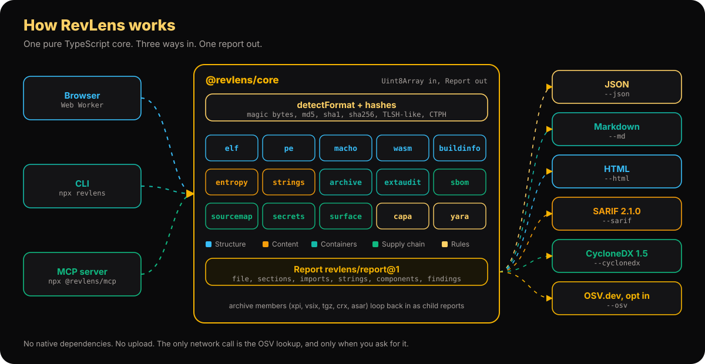
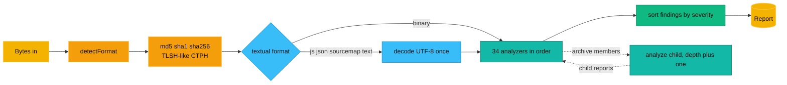
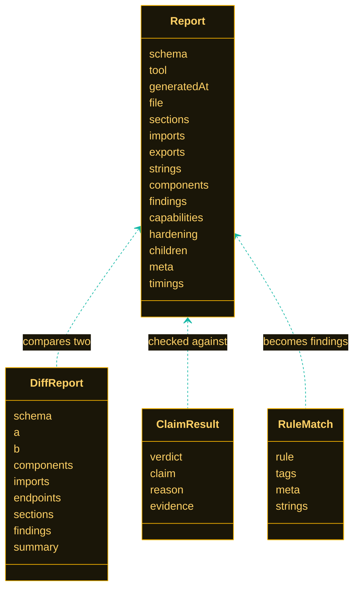
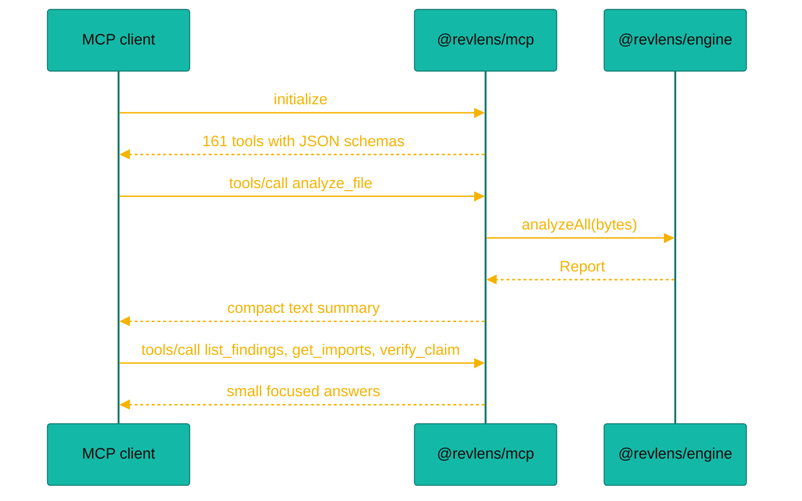

# Architecture

RevLens is one engine with three front doors. The engine, `@revlens/engine`, is a pure function from bytes to a report. It runs the core pipeline from `@revlens/core` and then the analyzers from every format package. The CLI, the MCP server and the web app each add only what their environment needs.



## The monorepo

| Path | Package | Role |
| --- | --- | --- |
| `packages/core` | `@revlens/core` | Format detection, hashes, the 15 core analyzers, yara-lite, diff, verify, output formats, OSV lookup. No Node built-ins in `src`. |
| `packages/disasm` | `@revlens/disasm` | x86, x86-64, AArch64, ARM and Thumb disassembly, ELF, PE and Mach-O loading, functions, CFG, xrefs, call graph and pseudo code. |
| `packages/mobile` | `@revlens/mobile` | APK, DEX, smali, Java class files, IPA plists, app frameworks and IL2CPP metadata. |
| `packages/managed` | `@revlens/managed` | .NET metadata and CIL, Python pyc and PyInstaller, Lua, BEAM and EVM bytecode. |
| `packages/webrt` | `@revlens/webrt` | JavaScript deobfuscation, bundle unpacking, source maps, Electron ASAR and audit, PCAP, HAR and SQLite. |
| `packages/extras` | `@revlens/extras` | Demangling, deep PE and Authenticode, firmware, GPU code, model files, LNK, crash reports and the evidence ledger. |
| `packages/bridges` | `@revlens/bridges` | Drives Ghidra, radare2, rizin, jadx, apktool, ILSpy, Frida, gdb, lldb and more through `execFile`. Node only. |
| `packages/engine` | `@revlens/engine` | Runs every analyzer on one combined report (34 analyzers in the browser build, 37 with the Node only ones) and collects all agent tools and CLI commands. |
| `packages/cli` | `revlens` | The `revlens` command with 83 CLI commands. Reads files with `node:fs` and prints or writes results. |
| `packages/mcp` | `@revlens/mcp` | The MCP server with 161 MCP tools over stdio or Streamable HTTP (`revlens mcp --http`), built on `@modelcontextprotocol/sdk`. |
| `apps/web` | `@revlens/web` | Vite, React and Tailwind. Runs the engine in a Web Worker. Deployed to GitHub Pages under `/re/`. |
| `docs/` | | These pages, also rendered by the web app. |
| `content/blog/` | | Blog posts, rendered by the web app. |
| `samples/` | | Small real files for tests and the "Try a sample" buttons. |

Everything is TypeScript in strict mode, ESM only, built with npm workspaces on Node 22.12 or newer.

## The pipeline



`analyze(bytes, options)` in the core does these steps, and `analyzeAll` in the engine runs the same pipeline with the package analyzers added:

1. Detect the format from magic bytes, name and content.
2. Compute MD5, SHA-1, SHA-256, the TLSH-like digest, the CTPH digest and overall entropy.
3. If the format is textual, decode the bytes as UTF-8 once and share the text with every analyzer.
4. Build an `AnalyzerContext` with the bytes, the name, the format, the options, the depth, the growing report, the text, and an `analyzeChild` function for archive members.
5. Run each analyzer whose `applies(ctx)` returns true, and time it.
6. Sort findings from critical to info and record the total time.

Analyzers communicate through the report. The PE parser fills `report.imports`, and later the capability analyzer reads them. The strings analyzer fills `report.strings`, and later the secrets and surface analyzers search them for binaries.

## The analyzer contract

```ts
export interface Analyzer {
  id: string;
  title: string;
  description: string;
  applies(ctx: AnalyzerContext): boolean;
  run(ctx: AnalyzerContext): void | Promise<void>;
}
```

An analyzer may push into `report.sections`, `imports`, `exports`, `strings`, `components`, `findings` and `capabilities`, set `report.hardening`, and write its own data under `report.meta`. It should never throw on bad input on purpose, but if it does, the pipeline catches the error and records an `info` finding.

## Data model



## Outputs

All output functions take a `Report` and return a value. None of them do I/O.

| Function | Output |
| --- | --- |
| `toMarkdown(report)` | GitHub flavored Markdown with a summary table, findings, capabilities, components, sections and imports. |
| `toHTML(report)` | One self contained HTML file with an entropy strip, findings and components. Every value is HTML escaped. |
| `toSARIF(report)` | SARIF 2.1.0 with rules, results, byte regions and security severity scores. |
| `toCycloneDX(report)` | CycloneDX 1.5 with every component across the report and its children, deduplicated. |

## The web app

The web app loads `@revlens/engine` inside a Web Worker. The main thread hands the file bytes to the worker, the worker runs `analyzeAll`, and it posts the report back. That keeps the page responsive while a 10 MB binary is hashed and scanned. The docs and blog you are reading are rendered from the same Markdown files in the repo.

## The MCP server



The server keeps answers small on purpose. An agent can ask for a summary first and drill into findings, strings or imports only when it needs them.

## Adding an analyzer

1. Create `packages/core/src/analyzers/<name>.ts` and export an `Analyzer`.
2. Register it in `packages/core/src/analyzers/index.ts`. Put it after the analyzers whose output it reads.
3. Add a test in `packages/core/test/` that runs it on a real file from `samples/`. We do not mock file formats.
4. Document it in `docs/analyzers.md` with what it reads, what it reports and its limits.

See [CONTRIBUTING.md](https://github.com/aniruddhaadak80/re/blob/main/CONTRIBUTING.md) for the rest.
