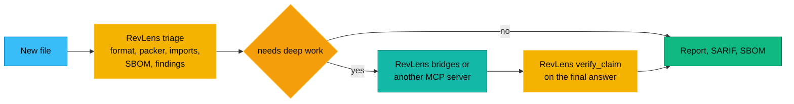

# Comparison

There are excellent reverse engineering tools for agents already. This page says plainly where RevLens is stronger, where it is weaker, and when you should use something else.

We built it from each project's README and docs as of 2026-11-11. Projects move fast. If something here is out of date, please open a pull request and we will fix it.

## At a glance

| | **RevLens 1.0** | REA | GhidraMCP | ida-pro-mcp | r2mcp | jadx-mcp |
| --- | --- | --- | --- | --- | --- | --- |
| Repo | [aniruddhaadak80/re](https://github.com/aniruddhaadak80/re) | [morluto/rea](https://github.com/morluto/rea) | [LaurieWired/GhidraMCP](https://github.com/LaurieWired/GhidraMCP) | [mrexodia/ida-pro-mcp](https://github.com/mrexodia/ida-pro-mcp) | [radareorg/radare2-mcp](https://github.com/radareorg/radare2-mcp) | [zinja-coder/jadx-mcp-server](https://github.com/zinja-coder/jadx-mcp-server) |
| Language | TypeScript and WASM | TypeScript | Java and Python | Python | C | Python, with a Java jadx plugin |
| License | MIT | MIT | Apache-2.0 | MIT | MIT | Apache-2.0 |
| What you install | Node, or nothing in the browser | Node plus the engines you pick | Ghidra, Java, the plugin | IDA Pro | radare2 | jadx GUI with the plugin, Python |
| Main strength | Answers first with nothing installed, evidence and checks | Breadth and deep engines | Free decompiler | Best in class decompiler | Light native engine | Android decompiled Java |
| Number of MCP tools | 185 | About 200 | A focused set | A focused set | A focused set | A focused set |

## Feature by feature

"Bridge" means RevLens drives the external tool when it is installed. "Partial" means the feature exists in a narrow form.

| Feature | RevLens | REA | GhidraMCP | ida-pro-mcp | r2mcp | jadx-mcp |
| --- | --- | --- | --- | --- | --- | --- |
| Runs in the browser | Yes | No | No | No | No | No |
| Works with nothing native installed | Yes | Partial | No | No | No | No |
| ELF, PE, Mach-O headers, imports, hardening | Yes | Yes | Yes | Yes | Yes | No |
| Built in disassembler, CFG, xrefs, call graph | Yes (x86, x86-64, ARM, AArch64) | Through engines | Yes | Yes | Yes | No |
| Decompiled C | Light pseudo code built in, Ghidra and r2ghidra by bridge | Yes, through engines | Yes | Yes, Hex-Rays | Yes, with plugins | No |
| Rename and annotate a database | No | Partial | Yes | Yes | Yes | Yes |
| Go function names on stripped binaries | Yes | Yes | Yes | Yes | Partial | No |
| Demangling C++, Rust, MSVC | Yes | Yes | Yes | Yes | Yes | No |
| Deep PE (resources, rich header, Authenticode check) | Yes | Yes | Partial | Partial | Partial | No |
| APK manifest and signatures | Yes | Yes | No | No | No | Partial |
| DEX smali and Java class disassembly | Yes, matches baksmali and javap | Through jadx | No | No | No | Yes |
| Decompiled Java | jadx by bridge | Yes, jadx | No | No | No | Yes |
| IPA plist, entitlements, code signature | Yes | Partial | No | No | No | No |
| .NET metadata and CIL | Yes | Yes | No | Partial | No | No |
| Decompiled C# | ILSpy by bridge | Yes | No | No | No | No |
| Python pyc and PyInstaller | Yes | Yes | No | No | No | No |
| Lua, BEAM, EVM bytecode | Yes | Partial | No | No | No | No |
| JavaScript deobfuscation and bundle splitting | Yes | Yes | No | No | No | No |
| Electron ASAR and security audit | Yes | Yes | No | No | No | No |
| PCAP, HAR, SQLite | Yes | Yes | No | No | No | No |
| Firmware containers | Yes, scan and parse; binwalk by bridge | Yes, binwalk and unblob | No | No | Partial | No |
| Runtime hooking and debugging | Frida, gdb and lldb by bridge, needs consent | Yes | No | Debugger support | Partial | No |
| Live website capture | Playwright, opt in | Yes | No | No | No | No |
| SBOM, OSV lookup, yara-lite rules | Yes | Partial | No | No | No | No |
| SARIF for code scanning, release diffs | Yes | Partial | No | No | No | No |
| Claim checks against bytes and an evidence ledger | Yes | Yes, evidence first | No | No | No | No |
| MCP over stdio and HTTP | Yes | Yes | Yes | Yes | Yes | Yes |
| Agent skill and plugins | Yes | Yes | No | Partial | No | No |

## Where RevLens is weaker

- **Decompiler quality.** The built in pseudo code does not recover types, stack variables or `switch`. For serious native work you want Ghidra or IDA, either directly or through the RevLens bridges.
- **Interactive databases.** RevLens does not keep a project where you rename functions and add comments. GhidraMCP, ida-pro-mcp and r2mcp do.
- **Breadth of live capture.** REA covers more runtime and desktop capture scenarios, process recordings and agent environments. RevLens covers Frida, gdb, lldb, adb and Playwright.
- **Maturity.** REA and the engine MCP servers have more users and more years behind them.

## When to use which

**Use RevLens when** you want an answer in seconds without installing anything, in a browser tab, in CI as SARIF or CycloneDX, or inside an agent loop that should check its claims. Also when you want one toolkit across native, mobile, managed, web and data files that uses the big engines only when they are there.

**Use REA when** you want one platform that reaches into many deep engines and runtime capture scenarios, and you are happy to install what that takes.

**Use GhidraMCP or ida-pro-mcp when** you need to read, rename and annotate decompiled functions. Ghidra is free. IDA is the industry standard and needs a license.

**Use r2mcp when** you like radare2 and want a light native engine that works well with local models.

**Use jadx-mcp when** you work only on Android apps and want jadx's decompiled Java inside the jadx GUI.

## Better together

RevLens narrows the question. A deep engine answers it when needed. RevLens checks the answer against the bytes before it reaches you.

## About REA

RevLens is inspired by [REA, Reverse Engineer Anything](https://github.com/morluto/rea) by morluto, which is MIT licensed. REA showed how natural reverse engineering becomes when an agent can drive the tools. RevLens is written from scratch, is not affiliated with REA, and is not an official REA project.

## Other projects worth knowing

- [reverify](https://github.com/2akouwu/reverify): a Python "propose, then verify" gate for native binaries. Our `verify_claim` follows the same idea.
- [Mandiant capa](https://github.com/mandiant/capa): the real capability detector. Our capa-lite is a lighter cousin.
- [webcrack](https://github.com/j4k0xb/webcrack): deobfuscates and unpacks JavaScript bundles.
- [jshookmcp](https://github.com/vmoranv/jshookmcp): a very broad web and JavaScript runtime MCP server (AGPL-3.0).
