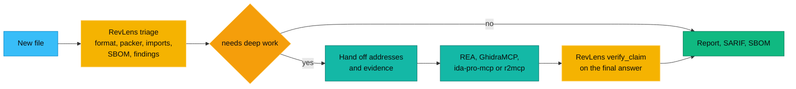

# Comparison

There are excellent reverse engineering tools for agents already. RevLens does not try to beat them at what they do best. It covers the jobs they leave open: zero install triage, supply chain checks, rules, CI output and claim checking, in a form that runs anywhere JavaScript runs.

We built this page from each project's README and docs as of 2026-11-10. Projects move fast. If something here is out of date, please open a pull request and we will happily fix it.

## At a glance

| | **RevLens** | REA | GhidraMCP | ida-pro-mcp | r2mcp | jshookmcp |
| --- | --- | --- | --- | --- | --- | --- |
| Repo | [aniruddhaadak80/re](https://github.com/aniruddhaadak80/re) | [morluto/rea](https://github.com/morluto/rea) | [LaurieWired/GhidraMCP](https://github.com/LaurieWired/GhidraMCP) | [mrexodia/ida-pro-mcp](https://github.com/mrexodia/ida-pro-mcp) | [radareorg/radare2-mcp](https://github.com/radareorg/radare2-mcp) | [vmoranv/jshookmcp](https://github.com/vmoranv/jshookmcp) |
| Language | TypeScript | TypeScript | Java | Python | C | TypeScript |
| License | MIT | MIT | Apache-2.0 | MIT | MIT | AGPL-3.0 |
| What you install | Node, or nothing in the browser | Node plus the engines you pick | Ghidra, Java, the plugin | IDA Pro | radare2 | Node, browser automation |
| Main strength | Fast triage and supply chain | Breadth and deep engines | Free decompiler access | Best in class decompiler access | Light native engine | Web and JS runtime work |

## Feature by feature

"Partial" means the feature exists through an external tool or in a narrow form.

| Feature | RevLens | REA | GhidraMCP | ida-pro-mcp | r2mcp | jshookmcp |
| --- | --- | --- | --- | --- | --- | --- |
| Runs in the browser | Yes | No | No | No | No | No |
| Zero native dependencies | Yes | Partial | No | No | No | Partial |
| Deep decompilation | No | Yes, through engines | Yes | Yes | Yes | Partial, through bridges |
| ELF, PE, Mach-O headers and imports | Yes | Yes | Yes | Yes | Yes | Partial |
| Import hash | Yes | Yes | Not listed | Not listed | Not listed | Not listed |
| WebAssembly imports and exports | Yes | Yes, with WABT | No | No | Partial | Yes |
| Entropy map and packer markers | Yes | No | No | No | Partial | Partial |
| YARA style rules without native yara | Yes | No | No | No | Partial | No |
| Capabilities mapped to ATT&CK | Yes | No | No | No | No | No |
| SBOM from JS bundles and Go build info | Yes | Partial, Go and Rust metadata | No | No | No | No |
| CycloneDX output | Yes | No | No | No | No | No |
| OSV vulnerability lookup | Yes, opt in | No | No | No | No | No |
| Source map detection and coverage | Yes | Partial | No | No | No | Yes, with rebuild |
| Secrets scanning with redaction | Yes | Partial | No | No | No | Partial |
| Browser extension, VSIX and npm tarball audit | Yes | No | No | No | No | No |
| Release to release diff | Yes | Partial, compare tools | No | No | Partial | No |
| SARIF for code scanning | Yes | No | No | No | No | No |
| Claim verification against bytes | Yes | Partial, evidence and unknowns | No | No | No | No |
| Runtime hooking with Frida | No | Yes | No | No | No | Yes |
| Live website and network capture | No | Yes | No | No | No | Yes |
| Android APK deep analysis | Partial, listing and manifest | Yes | No | No | No | Partial |
| Number of MCP tools | 12 | About 200 | A focused set | A focused set | A focused set | 736, with a search profile |

## When to use which

**Use RevLens when** you want an answer in seconds without installing anything, when you need results in CI as SARIF or CycloneDX, when you audit a dependency, extension or VSIX before installing it, when you compare two releases, or when your agent needs a small tool surface and a way to check its own claims.

**Use REA when** you want one platform that reaches into many deep engines, runtime capture, websites, Android and more, and you are happy to install what that takes.

**Use GhidraMCP or ida-pro-mcp when** you need to read and rename decompiled functions. Ghidra is free. IDA is the industry standard and needs a license.

**Use r2mcp when** you like radare2 and want a light native engine that works well with local models.

**Use jshookmcp when** the target is a live website or a running JavaScript app and you need browser automation, network interception or runtime hooks.

## Better together

The flow we recommend for agents:

RevLens narrows the question. The deep engine answers it. RevLens checks the answer against the bytes before it reaches you.

## About REA

RevLens is inspired by [REA, Reverse Engineer Anything](https://github.com/morluto/rea) by morluto, which is MIT licensed. REA showed how natural reverse engineering becomes when an agent can drive the tools. RevLens is written from scratch, is not affiliated with REA, and is not an official REA project. We think of it as a complement: a small, portable layer for the questions that come before and after a deep dive.

## Other projects worth knowing

- [reverify](https://github.com/2akouwu/reverify): a Python "propose, then verify" gate for native binaries. Our `verify_claim` follows the same idea.
- [Mandiant capa](https://github.com/mandiant/capa): the real capability detector, with disassembly. Our capa-lite is a lighter cousin.
- [webcrack](https://github.com/j4k0xb/webcrack): deobfuscates and unpacks JavaScript bundles. RevLens tells you when a bundle needs it.
- [binwalk](https://github.com/ReFirmLabs/binwalk): firmware extraction, which RevLens does not do.
